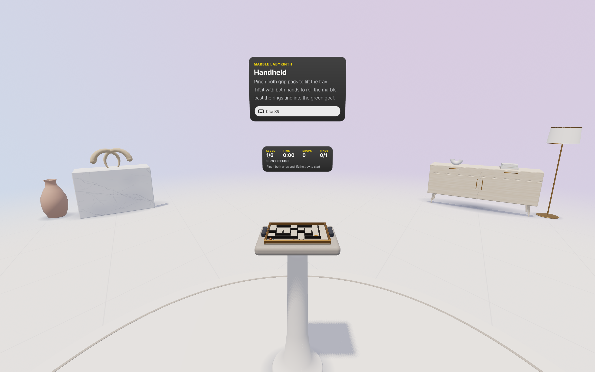
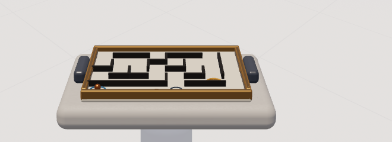
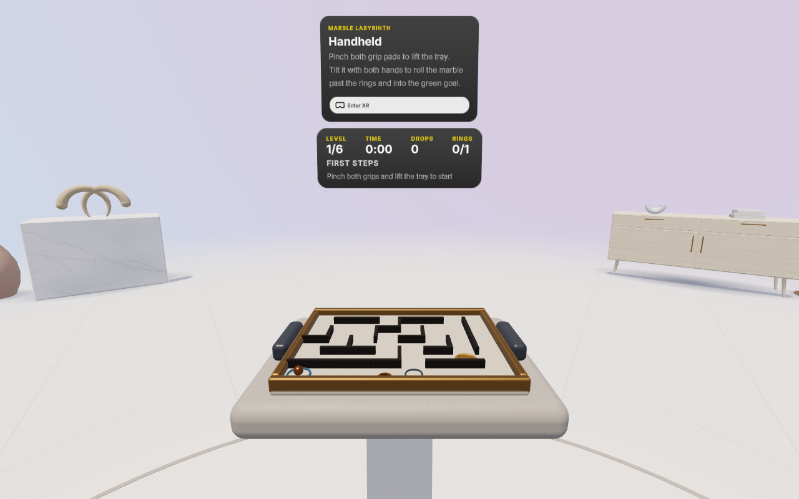

# Handheld — a bimanual marble labyrinth for Meta Quest

Handheld is a real-time marble labyrinth that exists only in your hands. There is
no virtual table and no controller-driven board: you pinch both grip pads, lift
the tray off its stand, and the tray *is* the physics world. Tilt it and the
marble rolls; over-tilt it and the marble falls off.

Built with [IWSDK](https://iwsdk.dev) 1.1 (`@iwsdk/core`) and Three.js for the
Meta Horizon Start Developer Competition. Hand tracking first, controller
friendly.





Submission copy — name, tagline, description and a video shot list — lives in
[`SUBMISSION.md`](SUBMISSION.md).

## How it plays

1. **Lift** — pinch both grip pads on the sides of the tray. Lifting it off the
   stand starts the run and its clock.
2. **Tilt** — the tray's world orientation defines local gravity, so every degree
   you rotate with your hands is a degree the marble feels. Board-local gravity is
   world gravity rotated by the inverse of the tray's world quaternion.
3. **Route** — roll the marble through the amber checkpoint rings in order, then
   into the green goal. Six deterministic layouts of increasing length.
4. **Recover** — a fingertip inside the rim nudges a stalled marble (the grips sit
   outside the rim, so holding the tray never pokes it). Tip the tray past
   `TIPPED_COS` for 0.45 s to drop the marble and restart the route at a five
   second penalty.
5. **Finish** — clearing the last level shows the run summary; tip the tray to
   play again.

A released tray that drifts too far from its stand, or falls below 0.42 m, eases
back home instead of being lost.

## Hand interactions

| Interaction | Implementation |
| --- | --- |
| Two-handed grip | `TwoHandsGrabbable` on the `tray` node (`rotate` + `translate`, no `scale`) |
| Grab state | `Grabbed` queried every frame to gate the state machine |
| Tilt to gravity | `getWorldQuaternion` on the tray, inverted, applied to world gravity |
| Fingertip poke | `world.playerSpaceEntities.indexTipSpaces`, converted to tray-local space, inside the rim and below 0.03 m |
| Tip to reset | Tray up-axis against world up (`cos < 0.45`) held for 0.45 s |
| Panel input | `RayInteractable` on the welcome card |

No locomotion and no physics engine: the marble is a purpose-built 2D simulation
with fixed sub-steps, so it cannot tunnel through a wall or over a trap hole even
on a long frame.

## Attract mode and keyboard fallback

Two URL flags stand in for the player's hands, for a laptop that cannot pinch:

| URL | What it does |
| --- | --- |
| `?demo` | Attract mode: the tray lifts itself, then plays all six mazes with a damped controller that follows each level's solution route. It drops the marble into a trap hole once, tips the tray over once, and tips again after the run summary to restart. The page camera frames board, HUD and title card. |
| `?keys` | Arrow keys tilt the tray, space tips it over to reset; the tray lifts on its own. |

Both go through the path a real grip does: they only write the tray's world pose,
and the system still derives board-local gravity from it, so the marble is never
moved by anything but tilt. Neither is reachable without the query flag, which
keeps the shipped game hands-only.



To film Handheld without a headset, open the build with `?demo` and record the
browser window: one pass covers the whole loop — lift, six levels, a drop, a tip
reset and the summary — in about seventy seconds, hands free. Record fullscreen
(`F11`), so the tab strip and address bar stay out of the take, and stop when the
summary tips back into a new run: that is the whole loop.

The demo moves the board the way a hand would, never in a single frame: the aim
point is eased towards each new target, the tilt itself is eased towards the
aim, and even the scripted tip rolls the tray over in a fifth of a second. That
is what keeps a scripted grip from looking like a glitch on camera.

## Project layout

```
src/
  index.ts                    world bootstrap; registers PanelSystem + LabyrinthSystem
  assets.ts                   code-built scene assets + the two UIKitML documents
  components.ts               LabyrinthState (state mirror on the tray entity)
  panel.ts                    welcome card: Enter/Exit XR
  labyrinth/
    labyrinth-system.ts       tilt -> gravity, hold state, home return, state machine
    marble-sim.ts             fixed-step marble integration, walls, holes, impacts
    levels.ts                 deterministic maze generation (walls, holes, rings)
    board-view.ts             walls, rings, goal and marble meshes
    tray-driver.ts            attract mode (?demo) and keyboard fallback (?keys)
    hud-view.ts               UIKitML scoreboard setters
    labyrinth-state.ts        ECS fields mirrored for tooling
    cues.ts                   procedural audio cues
    tray.scene-asset.ts       the tray the player grips
  scene-assets/               studio floor, stage, stand, background decor
public/
  scenes/main.iwsdk.scene.json  authored scene (tray, stand, scoreboard, lights)
  ui/handheld.uikitml           run HUD
  ui/welcome.uikitml            title card
```

## Develop

```sh
npm install
npm run dev          # managed browser + IWER emulator on https://localhost:8081
npm run dev:runtime  # plain Vite server, no managed browser
npm run typecheck    # tsc --noEmit
npm run build        # production bundle in dist/
```

`iwsdk.config.json` holds the scene, asset and component modules plus the XR
settings (VR mode, `handTracking: true`, no locomotion or physics).

## Deploy

`npm run build` emits a static bundle with a relative `base`, so `dist/` can be
served from any HTTPS host (GitHub Pages, Vercel, Netlify). `npm run preview`
serves that bundle locally over HTTPS for a final check before shipping.

`.github/workflows/deploy.yml` builds and publishes `dist/` to GitHub Pages on
every push to `main`/`master`: enable Pages with the "GitHub Actions" source and
the workflow does the rest. WebXR needs HTTPS outside `localhost`, which both
Pages and Vercel provide.
